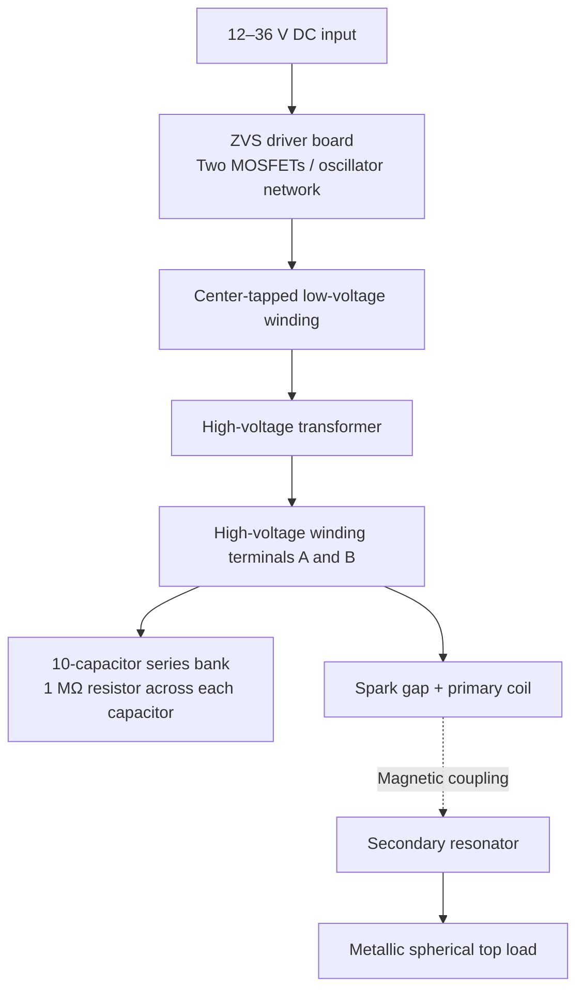

# Tesla Coil — GY19206

**Spark-Gap Tesla Coil | ZVS-Driven High-Voltage Supply | Circuit Reconstruction**

This repository documents my assembly, testing, and electrical analysis of a **PEMENOL GY19206 DIY Tesla coil kit**. The project combines a zero-voltage-switching (ZVS) power driver, a high-voltage transformer, a spark-gap resonant circuit, and a copper-wound secondary coil with a spherical top load.

The physical device was **assembled from a commercial kit**. My work documented here includes the assembly, inspection of its electronic stages, a hand-drawn wiring sketch, photographic testing, and a **working reconstruction of the circuit**. This is not presented as an original, from-scratch Tesla-coil design.

> **Project status:** Assembled and demonstrated producing visible electrical discharges.  
> **Documentation status:** Functional circuit reconstruction completed; component-level PCB netlist and electrical operating values remain unverified.


## Project objectives

- Explore resonant transformers, inductive coupling, and high-frequency high-voltage generation.
- Understand how a ZVS oscillator drives a transformer and charges a spark-gap resonant network.
- Assemble and inspect a physical Tesla coil, including its driver, capacitor bank, primary, and secondary stages.
- Reconstruct the electrical topology from the available manual, hardware photographs, and wiring connections.
- Document observed performance separately from manufacturer claims and theoretical calculations.

## Demonstrated operation

The completed system generated branching violet electrical streamers from the metallic top-load sphere. The photographs below document operation, but **streamer length, output voltage, current, and operating frequency were not instrumentally measured**.

| Operating discharge — view 1 | Operating discharge — view 2 |
|:--:|:--:|
|  |  |

## Published specifications

The following values are from the GY19206 kit documentation or the supplied reference image. They should **not** be treated as measurements of this particular build.

| Parameter | Published / reference value |
|---|---|
| Kit / model | PEMENOL GY19206 |
| Circuit type | Spark-gap Tesla coil with a ZVS-driven HV supply |
| DC supply input | 12–36 V DC |
| Recommended input power | 60–80 W |
| Suggested adapter in detailed guide | 19 V / 4.7 A |
| Reference base footprint | 150 × 150 mm |
| Reference base height | Approx. 100 mm |
| Secondary coil | Approx. 40 mm diameter × 240–247 mm winding/tube height (sources vary) |
| Top-load sphere | Approx. 60 mm diameter (reference image) |
| Advertised arc length | Up to 10 cm; 15 cm is a vendor tuning claim, not a verified result |

## System architecture

The system contains **two distinct electrical resonant stages**: the low-voltage ZVS driver and the high-voltage spark-gap Tesla-coil circuit. The two large film capacitors visible on the driver board are **not** part of the ten-capacitor high-voltage bank.



*Functional block diagram only. It is not a verified pin-by-pin schematic; the high-voltage capacitor bank and the spark-gap/primary branch are connected across the transformer high-voltage winding.*

### Main subsystems

| Subsystem | Observed hardware / documented function |
|---|---|
| ZVS driver board | PCB marked **ZVS**, with two heatsinked MOSFET positions, a toroidal inductor, diodes, resistors, and large film capacitors. The detailed kit guide specifies **IRFP250** MOSFETs. |
| Transformer drive winding | Center-tapped winding with three connections, used to excite the high-voltage transformer. Exact turns and polarity were not independently verified. |
| High-voltage capacitor bank | **10 capacitors in series**, with an approximately **1 MΩ resistor across each** (per manual and wiring sketch). |
| Spark gap | Separate discharge switch in the primary resonant circuit. |
| Primary winding | Short copper winding around the lower secondary support. Actual inductance not measured. |
| Secondary winding | Tall, fine-wire copper solenoid, magnetically coupled to the primary; exact turn count and inductance unknown. |
| Top load | Conductive spherical terminal attached at the top of the secondary. |

### Hardware photographs

| ZVS driver board | High-voltage capacitor bank |
|:--:|:--:|
|  |  |

| Transformer winding | Hand-drawn working circuit |
|:--:|:--:|
|  |  |

## Circuit reconstruction

The functional high-voltage topology was derived by comparing the kit reference materials, the exposed wiring, the separate capacitor-bank photo, and my hand-drawn connections:

1. The high-voltage transformer winding spans two HV nodes (**A** and **B**).
2. The series capacitor bank is connected across these HV nodes.
3. The spark gap and primary winding form another branch across the same nodes.
4. The secondary coil is **magnetically**, not directly electrically, coupled to the primary winding.
5. The secondary's exact RF return / grounding implementation was not verified from photographs.

The ZVS driver is clearly identified by its PCB silkscreen. Its exact MOSFET gate-drive connections, trace routing, and switching frequency **cannot be certified without a reliable PCB netlist and measurements**.

**Detailed reconstruction:** [Tesla Coil GY19206 — Electrical Reconstruction v2.0 (PDF)](docs/Tesla_Coil_GY19206_Reconstruction_v2.pdf)

> The linked PDF is a working engineering interpretation, **not** an official manufacturer schematic, validated service drawing, or operational safety certification.

## Resonant-circuit analysis

The nominal high-voltage bank capacitance for ten identical series-connected capacitors is:

$$
C_{\mathrm{bank}} = \frac{C_{\mathrm{single}}}{10}
$$

For the **0.30–0.45 µF per-capacitor range stated in the detailed guide**:

$$
C_{\mathrm{bank}} \approx 30\text{–}45\ \mathrm{nF}
$$

The idealized primary resonant frequency is:

$$
f_p = \frac{1}{2\pi\sqrt{L_p C_{\mathrm{bank}}}}
$$

For illustration only, if **$L_p = 0.50\ \mu\mathrm{H}$** and **$C_{\mathrm{bank}} = 32\ \mathrm{nF}$**:

$$
f_p \approx 1.26\ \mathrm{MHz}
$$

**Important qualifications:** Neither the actual primary inductance nor the individual high-voltage capacitor values has been measured. The photographed **0.32 µF** marking refers to a **ZVS-driver film capacitor**, and must **not** be assumed to be the value of every capacitor in the separate HV bank. Real spark-gap operation is also affected by parasitic capacitance, inductance, coupling, and damping. The ZVS switching frequency, spark-gap repetition rate, and Tesla coil RF resonance are distinct quantities.

## Verified observations and open questions

**Supported by the build photographs and documentation:**

- The complete coil and external power-driver assembly exist and have been assembled.
- The PCB is labeled **ZVS**; a center-tapped winding and separate HV capacitor bank are visible.
- The capacitor bank uses a series arrangement with resistor shunts.
- The coil has produced multiple visible electrical discharges in testing.

**Not yet independently verified:**

- Exact driver-board MOSFET pin-to-pin netlist or component tolerances.
- Transformer high-voltage output, polarity, and winding turns.
- Primary / secondary inductances, mutual coupling, and resonant frequencies.
- Output voltage, current, arc length, power consumption, and efficiency.
- Actual RF ground connection and clearances under controlled test conditions.

## Safety notice

**Warning: this apparatus produces dangerous high voltage, RF fields, and electrical discharges.** Capacitors may retain hazardous charge after the DC input is removed, even when shunt resistors are installed. The device can cause electric shock, burns, fire, interference with electronics or implanted medical devices, and exposure to harmful byproducts of electrical discharge.

The photographs document experimental operation; they are **not an endorsement of the test setup as safe**. Do not touch energized components, attempt live probing of exposed high-voltage parts, operate near flammables or sensitive equipment, or assume the input power rating limits the voltage hazard. Inspection and measurements require appropriate high-voltage training, verified discharge procedures, RF grounding, protective clearances, and suitable equipment.

## Repository structure

```text
.
├── README.md
├── docs/
│   └── Tesla_Coil_GY19206_Reconstruction_v2.pdf
└── images/
    ├── assembled.jpg
    ├── discharge_01.jpg
    ├── discharge_02.jpg
    ├── zvs_driver.jpg
    ├── capacitor_bank.jpg
    ├── transformer_winding.jpg
    └── wiring_sketch.jpg
```

## References and attribution

- **Hardware origin:** PEMENOL GY19206 commercial DIY Tesla coil kit.
- **Manufacturer/reference information:** GY19206 kit documentation, original installation guide, and product reference image. Advertised specifications are attributed to these sources.
- **Build evidence and analysis:** Assembly/test photographs, wiring sketch, and circuit reconstruction in this repository.

This repository is an **educational project log and reverse-engineering analysis**, not a replacement for the manufacturer's instructions. No license for reuse of repository contents has been specified.
